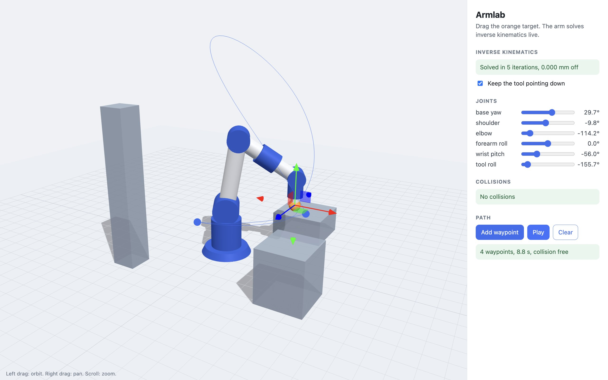

# Armlab

A robot arm simulator that runs in the browser. You drag a target around and a 6-joint arm solves inverse kinematics live to follow it, respecting its joint limits. You can drop waypoints, play a smooth trajectory through them, and see which links would hit the obstacles on the table.

I built it to actually understand the math behind arm control instead of calling a library, so all of the kinematics is in a small TypeScript module with no dependencies and its own tests. three.js is only used for drawing.



## Quick start

Needs Node 20 or newer.

```
git clone https://github.com/Mohith26/armlab.git && cd armlab
npm install && npm start
```

Then open http://localhost:5173. `npm start` compiles the TypeScript, copies three.js into `dist/vendor`, and serves the folder with a tiny static server. After a build, any static file server pointed at the repo root works too, and nothing is loaded from a CDN.

```
npm test        # 25 tests: FK, IK accuracy, joint limits, trajectories, collisions
npm run bench   # IK success rate and speed on random targets
```

In the page: drag the orange ball with the gizmo, tick "Keep the tool pointing down" to add an orientation constraint, use the sliders to drive joints directly, and use Add waypoint / Play to run a path.

## Example output

```
$ npm run bench
position only         restarts= 0  converged 1963/2000 (98.2%)  avg 0.072 ms/solve
position only         restarts=24  converged 2000/2000 (100.0%)  avg 0.063 ms/solve
position + direction  restarts= 0  converged 1361/2000 (68.0%)  avg 0.333 ms/solve
position + direction  restarts=24  converged 2000/2000 (100.0%)  avg 0.687 ms/solve
```

Targets come from forward kinematics of random in-limit poses, so all of them are reachable. "Converged" means the tool tip is within 0.1 mm (and within 0.001 rad of the requested direction). Timings are from my laptop.

## How it works

```
src/core/      kinematics, no dependencies
  math.ts        vectors, rotations, a small linear solver, seeded RNG
  arm.ts         arm description, forward kinematics, Jacobian
  ik.ts          damped least squares IK with joint limits
  trajectory.ts  quintic joint-space trajectories
  collision.ts   capsule-vs-box collision checks
src/ui/main.ts three.js scene and panel
test/          node:test suites for the core
```

Design notes:

- **Forward kinematics is a chain of translate-then-rotate.** Each joint has an offset from the previous joint and a rotation axis. The Jacobian comes straight from that: a revolute joint with world axis `a` at position `p` moves the tool tip at `a x (tip - p)`. A test checks it against finite differences.
- **IK is damped least squares with adaptive damping.** Each step solves `dq = J^T (J J^T + lambda^2 I)^-1 e`. The damping keeps steps sane near singularities, and lambda shrinks after a step that helps and grows after one that doesn't (Levenberg-Marquardt style). The direction constraint adds three rows for `target_dir - tool_dir`.
- **Joint limits use an active set, not just clamping.** A joint pinned at a limit that would be pushed further out gets its Jacobian column zeroed and the step is re-solved, so the other joints compensate. If a solve stalls in a local minimum it retries from seeded random poses. While dragging, the UI warm-starts from the current pose and only jumps to a restart solution if that one actually reaches the target, so the arm doesn't flail.
- **Collision distance uses convexity instead of special cases.** Links are capsules and obstacles are axis-aligned boxes. Distance from a point to a box is convex, and so is that distance along a straight segment, so a ternary search over the segment gives the exact closest distance. A test compares it to brute force on 300 random segments.

## Status

This is an early version. What works: FK, IK (position, or position plus tool direction), joint limits, quintic trajectories through waypoints with velocity and acceleration limits, and collision checks against boxes along a path. What doesn't yet:

- Trajectories are planned in joint space and only checked for collisions, not planned around obstacles. If a path hits something, you move a waypoint. A sampling-based planner (RRT-Connect) is the next thing I want to add.
- The arm stops at every waypoint. Blending through via points would make paths faster and smoother.
- IK uses restarts to escape local minima. A null-space term that pulls toward a comfortable rest pose would make solutions more consistent from frame to frame.
- No self-collision checks, and the arm geometry is fixed in code (no URDF loading).

MIT licensed.
